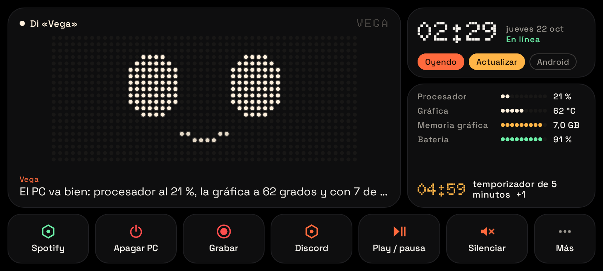

# Vega — a fully local voice assistant that gives old phones a second life

*Versión en español: [README.md](README.md)*

Vega is a voice assistant you talk to ("Vega, …") that is also a **button deck** (shut down the PC, music, open
apps…), something between Alexa and a Stream Deck.

- **The brain is your PC.** Speech-to-text, the language model and the voice all run locally: no subscriptions, no
  cloud, no internet needed (except optional song lyrics, and Telegram if you turn it on).
- **The body is an old Android phone** connected over **USB**: always-on screen with Vega's face, microphone,
  speaker, camera and touch buttons.
- **The goal: revive old devices.** The phone in your drawer plus an ordinary PC is all you need — no smart speaker
  or new hardware to buy.

> **Spanish-first.** Voice commands, the phone app and the docs are in Spanish today (English is on the roadmap).
> It's a personal project that's used daily, but expect rough edges.



## What it does

- Voice conversations with a local LLM (Qwen 3.5 4B via [Ollama](https://ollama.com)), Whisper speech-to-text and
  Kokoro/Piper voices.
- Instant skills without the LLM: reminders, timers, notes, memory ("remember that…"), weather, "good morning"
  and "good night" briefings.
- PC control with confirmation for risky actions: shutdown, lock, volume per app, wallpapers, launching games.
- Now-playing music with lyrics, live game stats (League of Legends, Rocket League, CS2, Forza…), PC notifications.
- University deadlines from Moodle with 1-hour alerts, a gym streak tracker, and an optional Telegram bot (with a
  safe "shut down my PC" button flow).
- Light on the GPU: ~700 MB of VRAM by default, and it moves the AI off the GPU automatically while you play.

## Install (Windows 10/11)

You need ~6 GB of disk, 8 GB of RAM (16 recommended) and an Android 8+ 64-bit phone with a USB cable. An NVIDIA GPU
helps but is **not required** (everything falls back to the CPU).

```powershell
git clone https://github.com/pangel1005/vega-asistente.git
cd vega-asistente
powershell -ExecutionPolicy Bypass -File scripts\instalar.ps1
```

The installer uses winget to add what's missing (uv, Ollama, adb), installs the Python dependencies, creates your
settings based on your GPU, downloads the language model (~3 GB) and the voices (~350 MB), and asks whether Vega
should start with Windows. It's safe to run again.

**Phone app:** enable *Developer options → USB debugging* on the phone (on Xiaomi also *Install via USB*), plug it in,
accept the prompt and run `scripts\android-install.ps1`. It builds and installs the app; it needs Java 17+ and the
Android SDK — the easiest way is to install Android Studio (`winget install Google.AndroidStudio`) and open it once.
A prebuilt APK is on the roadmap.

Then start Vega (`scripts\start.ps1`, or automatically at login) and plug in the phone: the server links it and opens
the app by itself. Say "Vega, ¿qué hora es?".

Your settings live in `config/assistant.toml` (created from `config/assistant.example.toml`, not tracked by git).

## Troubleshooting

| Problem | Fix |
|---|---|
| "No encuentro Java / el SDK de Android" | Install Android Studio, open it once, run `scripts\android-install.ps1` again |
| The phone isn't detected | Use a data cable, enable USB debugging and accept the prompt on the phone |
| "El teléfono rechazó la instalación" | Xiaomi: enable *Install via USB*. If Vega was installed from another PC, uninstall it first |
| Vega only writes, doesn't speak | Voices are missing: run `scripts\instalar.ps1` again |
| Something else | Check `logs/server.log` |

## Tried it? Tell me

Vega is new and I want to know how it works on other PCs and phones, especially old ones. If you try it — even if
you get stuck halfway:

- [🙋 I tried Vega](https://github.com/pangel1005/vega-asistente/issues/new?template=probe-vega.yml): how it went, on which PC and phone.
- [🐞 Bug](https://github.com/pangel1005/vega-asistente/issues/new?template=fallo.yml) · [💡 Idea](https://github.com/pangel1005/vega-asistente/issues/new?template=idea.yml)

If you like it, a ⭐ on GitHub helps other people find it.

## License

[MIT](LICENSE)
