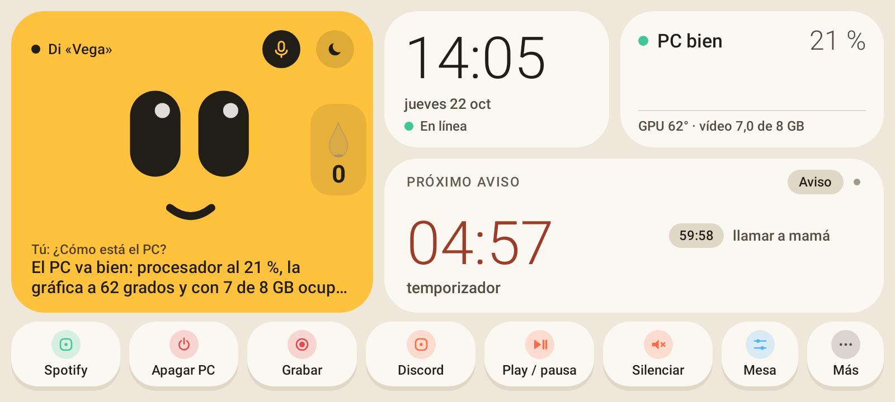
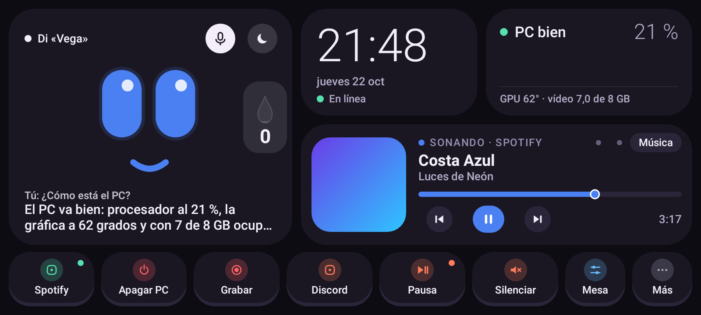
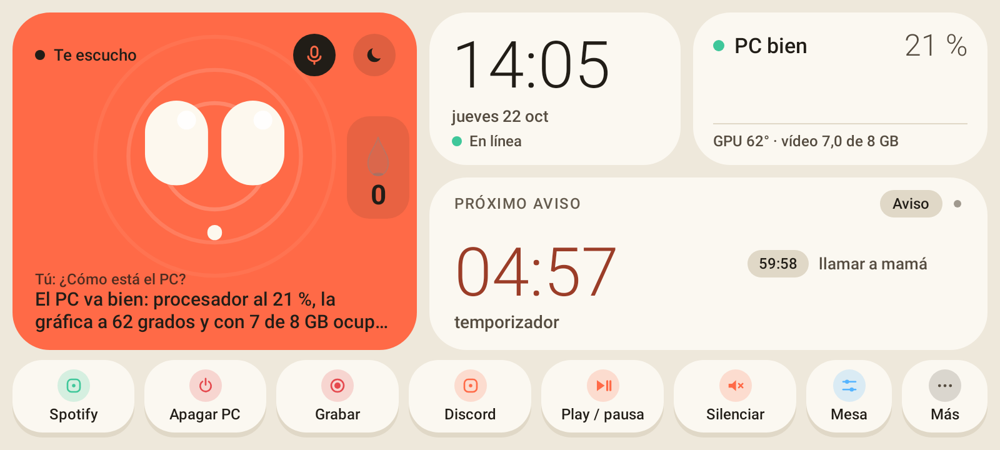
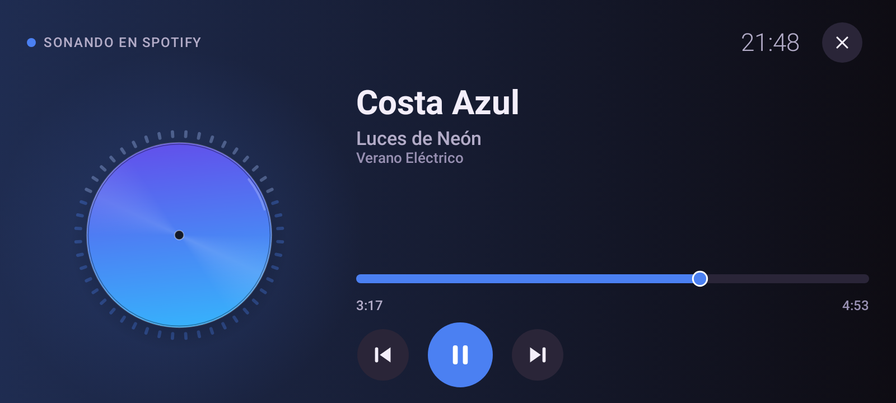
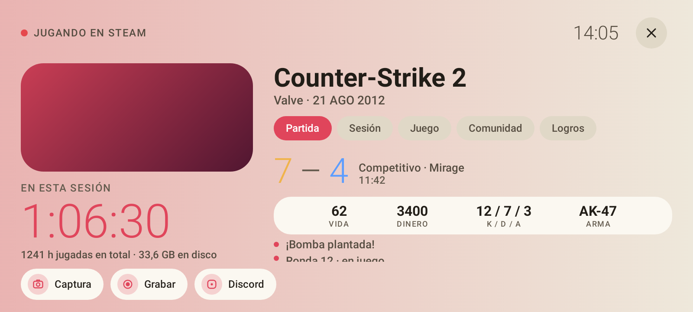
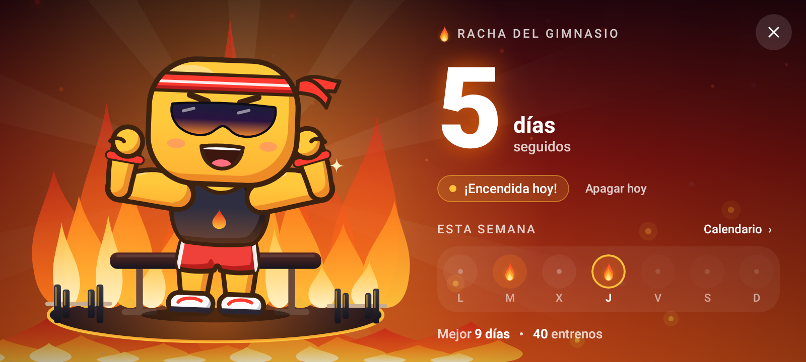
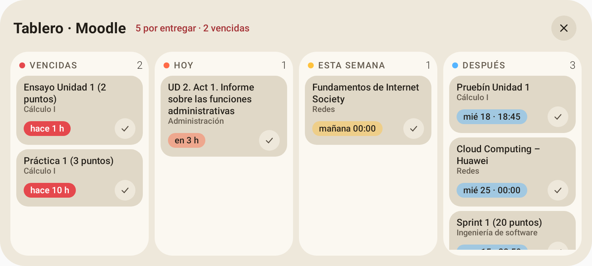
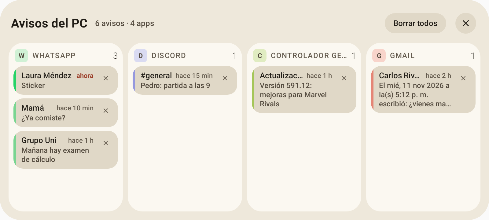
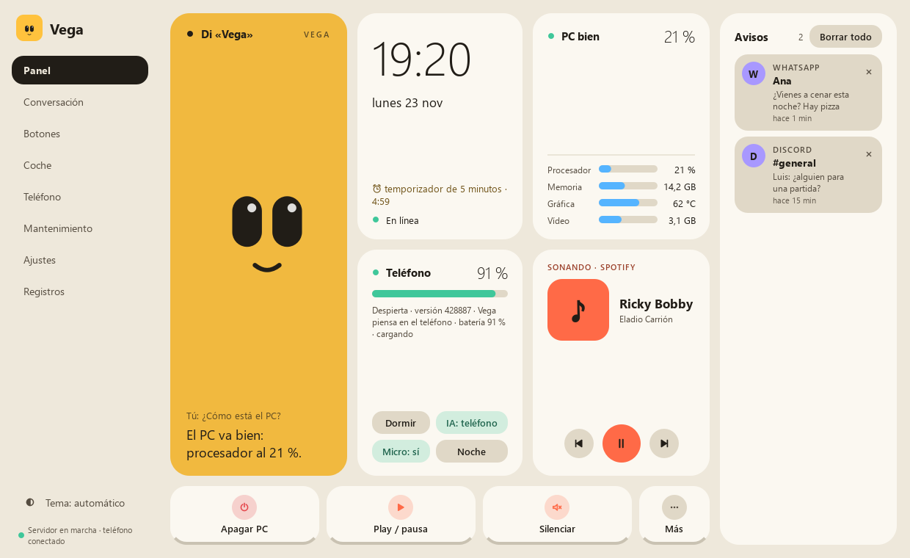
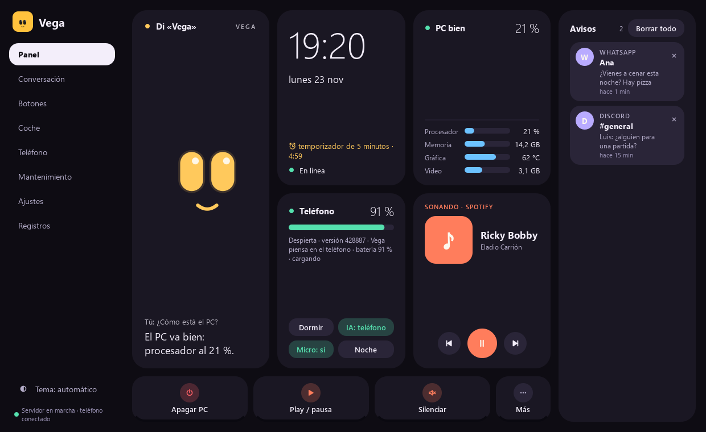

# Vega — asistente de voz 100 % local que revive teléfonos viejos

[English](README.md) · **Español**

Vega es un asistente al que le hablas («Vega, …») y que a la vez es una **botonera** para tu PC (apagar,
música, abrir juegos, volumen por programa…), como una mezcla de Alexa y Stream Deck.

- **El cerebro está en tu PC.** Entiende la voz, piensa la respuesta y habla con modelos de IA que corren en tu
  propio equipo: sin suscripciones y sin nube.
- **El cuerpo es un teléfono Android viejo** conectado por **cable USB**: pone la cara de Vega, el micrófono, el
  altavoz, la pantalla y las teclas.
- **La idea: revivir aparatos viejos.** El teléfono que tienes en un cajón y un PC normal bastan; no hay que
  comprar un altavoz inteligente ni nada nuevo. Y es ligera con la tarjeta gráfica: se aparta sola cuando juegas.

**Instalar:** `powershell -ExecutionPolicy Bypass -File scripts\instalar.ps1` (ver [Instalación](#instalación-windows)).

> **Proyecto personal en evolución.** Funciona y se usa a diario, pero espera fallos. Está pensada primero en
> español. El nombre «Vega» se cambia en `config/assistant.toml` (o en la app de escritorio).

| De día | De noche |
|---|---|
|  |  |

## Qué hace

| Le dices «Vega, …» | Hace |
|---|---|
| «buenos días» · «¿qué tengo hoy?» | Resumen del día: recordatorios, entregas de la universidad, tu racha del gimnasio y el tiempo |
| «buenas noches» · «me voy a dormir» | Pausa la música, te dice lo de mañana y la racha, y pregunta si apaga el PC |
| «recuérdame llamar a mamá en 20 minutos / a las 6 / mañana a las 8» | Recordatorio en voz alta (y por Telegram si el teléfono no está) |
| «pon un temporizador de 5 minutos» · «qué recordatorios tengo» | Temporizadores y recordatorios, con cuenta atrás en pantalla |
| «recuerda que me gusta el café sin azúcar» · «qué sabes de mí» | Memoria sobre ti; la usa también al conversar |
| «apunta comprar leche» · «lee mis notas» | Notas |
| «¿qué tareas tengo?» · «ya entregué el ensayo» | **Moodle:** tus entregas, con aviso 1 hora antes de que venzan |
| «fui al gimnasio» · «¿cómo va mi racha?» | **La llama del gimnasio:** racha de días, que se ve en la cara de Vega |
| «pon un fondo de anime» · «baja Discord» · «Spotify al 30» | Fondos de Wallpaper Engine y volumen por programa |
| «abre Fortnite» · «lanza Counter-Strike» | Abre tus juegos de Steam y Epic |
| «apaga el PC» · «sube el volumen» · «abre Spotify» | Botones del panel (con confirmación para lo peligroso) |
| «¿qué tiempo hace?» · «¿va a llover mañana?» | El tiempo (opcional, con tu ciudad) |
| «cómo está el PC» · «léeme el último mensaje» | Procesador, gráfica, memoria y batería; avisos del PC (WhatsApp, Discord…) |
| cualquier otra cosa | Conversación con el modelo de lenguaje |

Después de responderte, **sigue escuchando unos segundos sin que repitas «Vega»**.

**Además, sin que se lo pidas:**
- **Lo que suena en el PC** (Spotify, el navegador…): carátula, controles y **letra sincronizada**.
- **El juego que tienes abierto**, con tus horas y, en algunos juegos, la partida en vivo (League of Legends,
  Rocket League, Counter-Strike 2, Forza Horizon…).
- **Los avisos del PC** en el teléfono, agrupados por app.
- **La cámara del teléfono como webcam** de Windows (Discord, el navegador…), con un botón.
- **Telegram (opcional):** escríbele desde fuera de casa, recibe sus avisos y apaga el PC con botones de
  confirmación.

## El teléfono: Vega 2

La app del teléfono (Kotlin + Jetpack Compose) es la cara y el cuerpo de Vega:

- **De día y de noche:** papel y tinta de 7 a 20 h; tinta y luz el resto (o fijo, si lo eliges).
- **Una cara dibujada con curvas** que mira, parpadea y cambia con su ánimo: se agranda al escuchar, entorna un
  ojo al pensar, abre la boca al hablar. Los datos también se le ven: **suda** si la gráfica se calienta, baja
  los párpados con poca batería y lleva un **visor** mientras juegas.
- **Mosaicos grandes:** la cara, la hora, el estado del PC con su gráfica y un mosaico «Ahora» que va pasando por
  lo que importa (un aviso, Moodle, el PC, tus juegos, la música, la partida).
- **Teclas con relieve** con el icono real de cada programa, que actúan al tocar.
- **Pantallas propias:** Música (con letra), Juego, Tablero de Moodle, Avisos, Mesa (fondos y volumen por
  programa) y **Vega Fit**, la pantalla de la racha del gimnasio.
- **Se actualiza sola desde el PC** y puede ser la pantalla de inicio del teléfono.

| Escuchando | Música | Juego en curso |
|---|---|---|
|  |  |  |

| Vega Fit | Tablero de Moodle | Avisos del PC |
|---|---|---|
|  |  |  |

## La app de escritorio

Una app nativa de Windows con el mismo diseño: la cara de Vega, el PC, el teléfono, lo que suena, los avisos y
las teclas. Desde ella cambias los ajustes y los botones, controlas el teléfono y arrancas o paras Vega. Vive en
la bandeja del sistema. Ver [docs/escritorio.md](docs/escritorio.md).

| De día | De noche |
|---|---|
|  |  |

## Cómo funciona

```
 Teléfono Android viejo (app nativa)      cable USB          PC con Windows
 ┌─────────────────────────────┐        (adb reverse)    ┌───────────────────────────────────┐
 │ cara dibujada (Vega 2)      │ ◄──────────────────────► │ servidor Python (127.0.0.1:8000)   │
 │ micrófono continuo 16 kHz   │   WebSocket: eventos     │  ├─ oye: Whisper                   │
 │ altavoz (voz de Vega)       │   JSON + audio PCM       │  ├─ piensa: Qwen 3.5 4B (Ollama)   │
 │ mosaicos, teclas, pantallas │                          │  ├─ habla: Kokoro / Piper          │
 └─────────────────────────────┘                          │  ├─ habilidades sin IA             │
                                                          │  ├─ botones y control de Windows   │
              Telegram (opcional) ◄────────────────────── │  └─ memoria (SQLite)               │
                                                          └───────────────────────────────────┘
```

1. El teléfono manda el micrófono al PC todo el rato. El PC detecta cuándo empieza y acaba una frase y la pasa a
   texto.
2. Si la frase empieza por «Vega» (o acabas de hablar con ella), la atiende:
   - primero las **habilidades** (recordatorios, notas, Moodle, el gimnasio, el PC…): rápidas, fiables y sin
     usar la gráfica;
   - después, las **frases de los botones** («apaga el PC»), también por significado;
   - lo demás va al **modelo de lenguaje**.
3. La respuesta se convierte en voz frase a frase y suena en el teléfono mientras se sigue generando.

## Modelos de IA

Todo es local y gratuito. Medido en el PC del autor (RTX 4060 Ti de 8 GB, Ryzen 7 5700X, 32 GB de RAM).

| Para qué | Modelo | Dónde corre |
|---|---|---|
| Entender la voz | **Whisper** ([faster-whisper](https://github.com/SYSTRAN/faster-whisper)) `small`, con Silero VAD | Gráfica (~0,2–0,3 s por frase); con un juego abierto, `base` en el procesador |
| Pensar la respuesta | **Qwen 3.5 4B** con [Ollama](https://ollama.com) | Sin juego, casi todo en la gráfica (respuesta en ~0,7 s); con un juego abierto, se aparta a ~700 MB de vídeo |
| Hablar | **Kokoro 82M** ([kokoro-onnx](https://github.com/thewh1teagle/kokoro-onnx)), voces con acento latino | Procesador, 3–4 veces más rápido que el tiempo real |
| Hablar (alternativa) | **Piper** | Procesador, muy rápido pero más robótico |

**Vega sigue a tu PC:** cuando abres un juego, el modelo y la voz a texto pasan al procesador para no quitarle
nada al juego, y vuelven a la gráfica 20 s después de cerrarlo. **Sin tarjeta NVIDIA** también funciona: todo va
en el procesador, más despacio.

## Instalación (Windows)

**Qué necesitas**
- Windows 10 u 11, unos 6 GB libres y 8 GB de RAM (mejor 16).
- Una tarjeta gráfica NVIDIA ayuda, pero **no hace falta**.
- Un **teléfono Android viejo** (Android 8 o más nuevo, de 64 bits) y su cable USB.

**1. Descarga Vega**

```powershell
git clone https://github.com/pangel1005/vega.git
cd vega
```

(o *Code → Download ZIP* en GitHub y descomprímelo).

**2. Ejecuta el instalador**

```powershell
powershell -ExecutionPolicy Bypass -File scripts\instalar.ps1
```

Instala lo que falte con winget (uv, Ollama y adb) y las dependencias de Python. Crea tus ajustes según tu tarjeta
gráfica, baja el modelo de lenguaje (~3 GB) y las voces (~350 MB), y te pregunta si Vega arranca sola con Windows.
Se puede repetir cuando quieras: lo que ya está hecho se salta.

**3. Instala la app en el teléfono**

1. En el teléfono, activa las *Opciones de desarrollador* (toca 7 veces «Número de compilación») y dentro la
   **Depuración USB**. En Xiaomi activa también **Instalar vía USB**.
2. Conéctalo por USB y acepta el aviso de su pantalla.
3. Ejecuta `scripts\android-install.ps1` (el instalador también te lo ofrece). Compila la app e instálala. Hace
   falta Java 17+ y el SDK de Android: lo más fácil es instalar Android Studio (`winget install
   Google.AndroidStudio`) y abrirlo una vez. El script los encuentra solo.
   - Aún no hay un APK ya hecho para descargar: está en el plan.
   - En algunos Xiaomi sin SIM no se puede instalar por cable: ejecuta el script con `-BuildOnly`, copia el APK de
     `android\app\build\outputs\apk\release\` al teléfono e instálalo desde el gestor de archivos.

**4. Úsala**

Arranca Vega (`scripts\start.ps1`, o sola si lo elegiste) y conecta el teléfono: el servidor lo enlaza y abre la
app solo. Di «Vega, ¿qué hora es?».

**Opcional**
- App de escritorio: `scripts\escritorio.ps1`.
- Telegram: `uv run python -m server.tools.telegram_setup` · Moodle: `uv run python -m server.tools.moodle_setup`
  ([docs/telegram.md](docs/telegram.md), [docs/moodle.md](docs/moodle.md)).
- Cámara del teléfono como webcam: `winget install Genymobile.scrcpy OBSProject.OBSStudio` y `[camera] enabled =
  true`.
- `scripts\android-debloat.ps1` quita publicidad de HyperOS (reversible con `-Restore`).

**Si algo falla**

| Problema | Solución |
|---|---|
| «No encuentro Java» / «No encuentro el SDK de Android» | Instala Android Studio, ábrelo una vez y repite `scripts\android-install.ps1` |
| El teléfono no aparece | Cable de datos (no solo de carga), Depuración USB activada y acepta el aviso de la pantalla |
| «El teléfono rechazó la instalación» | Xiaomi: activa «Instalar vía USB». Si Vega ya estaba instalada desde otro PC, desinstálala antes |
| Vega no habla, solo escribe | Faltan las voces: repite `scripts\instalar.ps1` |
| Responde muy lento | Sin tarjeta NVIDIA es normal (2–5 s más). Cierra programas pesados o prueba un modelo más pequeño en `config/assistant.toml` |
| Algo raro | Mira `logs/server.log` |

## Uso diario

```powershell
powershell -ExecutionPolicy Bypass -File scripts\start.ps1 -Hidden   # arrancar
powershell -ExecutionPolicy Bypass -File scripts\stop.ps1            # parar y liberar la gráfica
powershell -ExecutionPolicy Bypass -File scripts\autostart.ps1       # arrancar con Windows (-Remove para quitarlo)
```

El arranque con Windows es una tarea programada «Vega (asistente)». Otra, «Vega (vigilante)», mira cada 5
minutos si Vega responde y, si se colgó, la reinicia. Los registros están en `logs/`.

## Configuración

| Archivo | Qué se cambia |
|---|---|
| `config/assistant.toml` | Nombre, modelo, instrucciones, voz, Whisper, Telegram, Moodle, cámara… Es tuyo (fuera de git): nace de `config/assistant.example.toml` |
| `config/actions.toml` | Botones: qué hacen, cuáles van en la fila principal, frases de voz y cuáles piden confirmación. Los de programas que no tienes no aparecen |
| `config/car.toml` | Casillas de la pantalla de Vega en Android Auto ([docs/coche.md](docs/coche.md)) |

## Seguridad y privacidad

- **Botones:** solo existe lo que está en `config/actions.toml`, y el servidor lo comprueba siempre.
- **Confirmación:** apagar, reiniciar y suspender piden un segundo toque o que digas «sí». Por Telegram, botones
  de confirmación y 60 s para cancelar.
- **Registro:** todo lo que se ejecuta queda en `logs/audit.log`.
- **Solo tu PC:** el servidor solo escucha en `127.0.0.1` y pide un token (`config/token.txt`, fuera de git).
- **Internet, solo para lo que activas:** letras de canciones ([lrclib.net](https://lrclib.net)), datos de los
  juegos de Steam, el tiempo, Moodle y Telegram. Cada uno se apaga en `config/assistant.toml`. Lo que le dices a
  Vega en voz alta no sale de tu PC.

## Estructura del proyecto

```
.
├── server/              Cerebro (Python 3.12, FastAPI)
│   ├── core/            Orquestador (oír → habilidades/botones/modelo → voz), ajustes, avisos, Telegram
│   ├── speech/          Whisper, Kokoro/Piper, detector de frases y de «Vega»
│   ├── llm/             Cliente de Ollama
│   ├── skills/          Habilidades sin IA: memoria, recordatorios, notas, Moodle, gimnasio, escritorio…
│   ├── device/          USB, música, juegos, avisos de Windows, cámara, fondos, volumen por programa
│   ├── memory/          SQLite: historial, datos sobre ti, notas, recordatorios, entregas, gimnasio
│   ├── tools/           Botones de Windows, instalador, asistentes de Telegram y Moodle
│   ├── ws/              Protocolo y ruta WebSocket
│   └── tests/           Pruebas (pytest)
├── android/             App del teléfono (Kotlin + Jetpack Compose)
│   └── app/src/main/java/com/asistente/personal/
│       ├── ui2/         Vega 2: tema día/noche, cara, mosaicos, pantallas
│       ├── ui/          Pantalla principal y piezas compartidas
│       ├── local/       IA del teléfono (sin PC): Whisper, Piper, habilidades
│       ├── car/         Android Auto
│       └── net/, audio/, state/
├── desktop/             App de escritorio (PySide6)
├── config/              Ajustes de serie, botones, coche y escena de OBS
├── scripts/             Instalar, arrancar, parar, arranque automático, instalar la app
├── tools/               Herramientas de desarrollo y medición
└── docs/                Documentación, hoja de ruta, investigación y capturas
```

## Hacia dónde va

[docs/hoja-de-ruta.md](docs/hoja-de-ruta.md) tiene el plan: un APK listo para descargar, mejor detección de
«Vega», conversación más natural, complementos y Wi-Fi. En
[docs/investigacion/proyectos-similares.md](docs/investigacion/proyectos-similares.md) está la comparación con
proyectos parecidos (Home Assistant, xiaozhi, GLaDOS…).

## Desarrollo

```powershell
uv run pytest; uv run ruff check server; uv run mypy          # servidor
uv run --group desktop pytest desktop/tests                     # app de escritorio
cd android; .\gradlew.bat testDebugUnitTest assembleRelease     # app del teléfono (JDK 21)
```

Las pruebas de las dos apps **dibujan capturas de pantalla** (Roborazzi en Android, Qt sin pantalla en el
escritorio) para revisar el diseño sin instalar nada. Cómo ha evolucionado el proyecto:
[docs/evolucion.md](docs/evolucion.md).

## ¿Lo probaste? Cuéntame

Vega es nueva y quiero saber cómo funciona en otros PC y teléfonos, sobre todo en los viejos. Si la pruebas,
aunque te atasques a medio camino:

- [🙋 Probé Vega](https://github.com/pangel1005/vega/issues/new?template=probe-vega.yml): cómo te fue, en qué PC y teléfono.
- [🐞 Algo falla](https://github.com/pangel1005/vega/issues/new?template=fallo.yml) · [💡 Una idea](https://github.com/pangel1005/vega/issues/new?template=idea.yml)

Y si te gusta, una ⭐ en GitHub ayuda a que más gente la encuentre.

## Licencia

MIT: ver [LICENSE](LICENSE).
