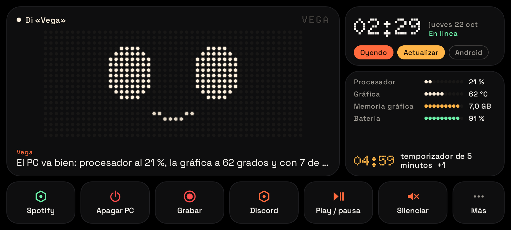
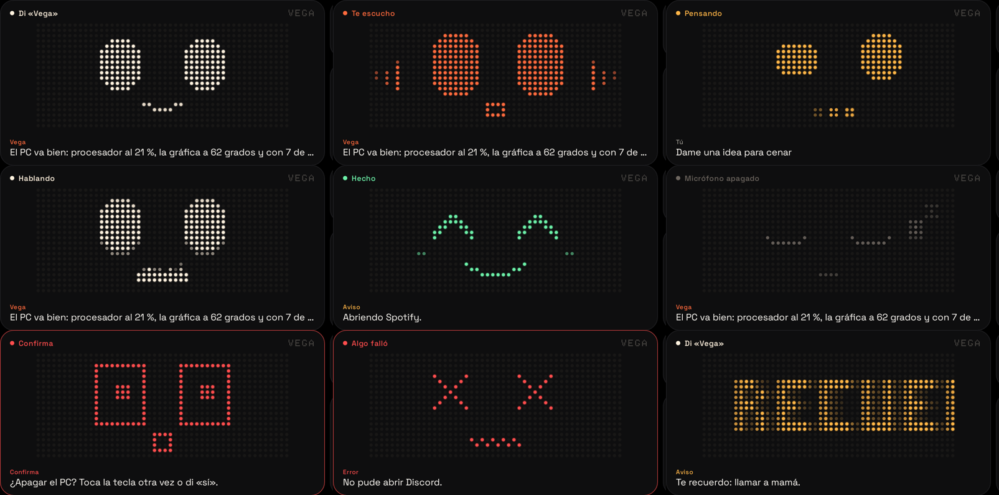
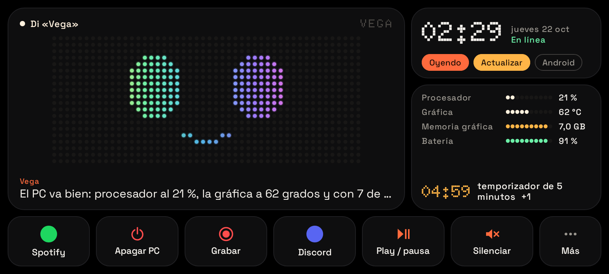
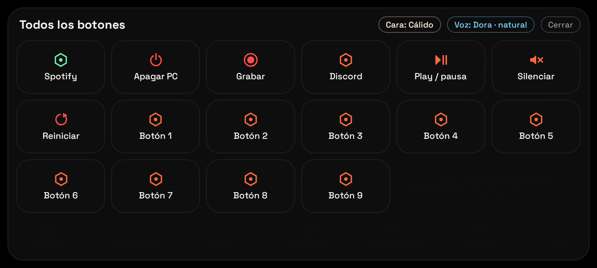

# Vega — asistente personal de voz, 100 % local

Vega es un asistente al que le hablas («Vega, …») y que a la vez es una **botonera**
(apagar el PC, música, abrir apps, grabar…), como una mezcla de Alexa y Stream Deck.

- **El cerebro está en tu PC.** Entiende la voz, piensa la respuesta y habla con modelos
  de IA que corren en tu propio equipo: sin servicios de pago, sin nube y sin internet (salvo, si quieres, las letras de canciones).
- **El cuerpo es un teléfono Android** conectado por **cable USB**. Pone la cara de LED,
  el micrófono, el altavoz y las teclas.

> **Prototipo personal en evolución.** Funciona y se usa a diario, pero espera fallos.
> El nombre «Vega» se cambia en `config/assistant.toml`.



## Cómo funciona

```
 Teléfono Android (app nativa)          cable USB            PC con Windows
 ┌───────────────────────────┐      (adb reverse)      ┌──────────────────────────────────┐
 │ cara de LED 48×20         │ ◄────────────────────► │ servidor Python (127.0.0.1:8000)  │
 │ micrófono continuo 16 kHz │   WebSocket: eventos   │  ├─ oye: Whisper (GPU)            │
 │ altavoz (voz de Vega)     │   JSON + audio PCM     │  ├─ piensa: Qwen 3.5 4B (Ollama)  │
 │ teclas + hoja «Más»       │                        │  ├─ habla: Kokoro / Piper (CPU)   │
 └───────────────────────────┘                        │  ├─ habilidades sin IA            │
                                                      │  ├─ botones de Windows            │
                                                      │  └─ memoria (SQLite)              │
                                                      └──────────────────────────────────┘
```

1. El teléfono manda el micrófono al PC todo el rato. El PC detecta cuándo empieza y
   acaba una frase y la pasa a texto.
2. Si la frase empieza por «Vega» (o acabas de hablar con ella), la atiende.
   - Primero prueba las **habilidades**: memoria, recordatorios, notas y estado del PC.
     Son rápidas, fiables y no usan la gráfica.
   - Después, las **frases de los botones** («apaga el PC»).
   - Lo demás va al **modelo de lenguaje**.
3. La respuesta se va convirtiendo en voz frase a frase y suena en el teléfono mientras
   se sigue generando. La cara mueve la boca con el volumen.

## Modelos de IA que usa

Todo es local y gratuito. Uso medido en el PC del autor (RTX 4060 Ti de 8 GB, Ryzen 7
5700X, 32 GB de RAM).

| Para qué | Modelo | Dónde corre | Detalles |
|---|---|---|---|
| Entender la voz (voz → texto) | **Whisper base** ([faster-whisper](https://github.com/SYSTRAN/faster-whisper)) | CPU | ~0,6 s por frase. Silero VAD para cortar silencios. `small` en GPU es más rápido, pero ocupa la gráfica |
| Pensar la respuesta | **Qwen 3.5 4B** (Q4_K_M) con [Ollama](https://ollama.com) | Casi todo en CPU (~3 GB de RAM) y 1 capa en GPU (~700 MB) | La gráfica solo lee la pregunta: primera palabra en ~0,5 s; escribe ~10 palabras/s. Se le pasan la fecha, la hora y lo que sabe de ti |
| Hablar (texto → voz) | **Kokoro 82M** ([kokoro-onnx](https://github.com/thewh1teagle/kokoro-onnx)) | CPU | Voces Dora, Alex y Santa (y mezclas), con acento latino. Unas 3–4 veces más rápido que el tiempo real |
| Hablar (alternativa) | **Piper** ([rhasspy/piper-voices](https://huggingface.co/rhasspy/piper-voices)) | CPU | Más robótica, pero unas 28 veces más rápida que el tiempo real |

**Probado y descartado:** Qwen3-TTS 0.6B, una voz más humana. En esta gráfica iba más
lento que el tiempo real y no cabía junto al modelo de lenguaje.

**Ligero con la tarjeta gráfica.** Vega ocupa ~700 MB de vídeo (antes ~4 GB): el modelo va
casi entero en el procesador y la gráfica solo lee la pregunta, que es lo que más tarda en
la CPU. Desde que terminas de hablar hasta que empieza su voz pasan unos 3–4 s.

| Reparto (`gpu_layers` en `config/assistant.toml`) | Vídeo | Primera palabra | Escribe |
|---|---|---|---|
| `0`: todo en el procesador | 0 MB | ~2,3 s | ~9 palabras/s |
| **`1`: por defecto** | **~700 MB** | **~0,5 s** | **~10 palabras/s** |
| `-1`: todo en la gráfica | ~3,7 GB | ~0,1 s | ~65 palabras/s |

## Qué hace ahora

| Le dices «Vega, …» | Hace |
|---|---|
| «recuerda que me gusta el café sin azúcar» · «qué sabes de mí» · «olvida que…» | Memoria sobre ti; la usa también al conversar |
| «recuérdame llamar a mamá en 20 minutos / a las 6 / mañana a las 8» | Recordatorio: lo dice en voz alta, el teléfono vibra y el texto cruza su cara. Si el teléfono estaba desconectado, avisa al conectarlo |
| «pon un temporizador de 5 minutos» · «qué recordatorios tengo» · «cancela…» | Temporizadores y recordatorios, con cuenta atrás en pantalla |
| «apunta comprar leche» · «lee mis notas» · «borra mis notas» | Notas |
| «cómo está el PC» | Procesador, memoria, gráfica (temperatura y uso) y batería del teléfono |
| «apaga el PC», «sube el volumen», «abre Spotify»… | Botones del panel (frases `say` en `config/actions.toml`) |
| cualquier otra cosa | Conversación con el modelo de lenguaje |

Después de responderte, **sigue escuchando 8 s sin que repitas «Vega»**, para seguir la
conversación. Tocar la cara tiene el mismo efecto.

**En el teléfono** (horizontal, pensado para un Redmi 15C):
- **Cara de LED con personalidad.** Mira alrededor, parpadea, guiña y tiene manías en
  reposo. Tiene expresiones para escuchar, pensar, hablar, contenta, dormida, error,
  confirmar algo peligroso y sin conexión.
- **Color de la cara elegible:** cálido, coral, cielo, menta, violeta, rosa o
  **arcoíris**.
- **Teclas que actúan al tocar**, sin esperar a soltar, con una vibración corta. Las
  apps llevan **su icono real**, que el PC saca del `.exe`.
- **Datos en vivo:** estado del PC, batería y el próximo aviso con cuenta atrás.
- **Lo que suena en el PC** (Spotify, el navegador…): canción, artista, carátula y
  progreso en un mini reproductor, con anterior, pausa y siguiente. Al tocarlo se abre
  la pantalla «Sonando», en grande y con el color de la carátula. Con el botón **Letra**
  muestra la letra sincronizada, con la línea que suena resaltada.
- **Se actualiza sola desde el PC:** aparece el botón **Actualizar**.
- Puede ser la **pantalla de inicio** del teléfono. El botón **Android** vuelve a
  HyperOS.



| Arcoíris | Hoja «Más» |
|---|---|
|  |  |

## En evolución / pendiente

| Tema | Estado |
|---|---|
| Voz más humana | Kokoro con acento latino, pausas y horas bien leídas. Las voces neuronales grandes no caben hoy en 8 GB junto al modelo de lenguaje |
| Modelo más listo | `qwen3:8b` descargado; es un trueque con la memoria de la gráfica |
| A veces adorna o pregunta de más | El modelo de 4B es pequeño. Las preguntas sobre ti se responden desde la memoria, sin el modelo |
| 120 Hz en el teléfono | HyperOS limita a 60 Hz las apps que no conoce. La app lo pide, pero el sistema manda |
| IA en el teléfono | Hecha («IA: teléfono» en «Más»): oye, entiende, usa sus habilidades y charla sin el PC. Es más lenta y menos lista que la del PC. Ver [docs/ia-en-el-telefono.md](docs/ia-en-el-telefono.md) |
| Coche (Android Auto) | Hecho y probado con pruebas automáticas; falta probarlo con el DHU y un coche real. Ver [docs/coche.md](docs/coche.md) |
| Wi-Fi | Aparcado: de momento, solo cable |
| Interfaz web (`http://127.0.0.1:8000`) | Antigua: chat escrito, sin panel de botones |
| Otros equipos (Raspberry Pi, otros Android) | Objetivo a largo plazo: que funcione en equipos modestos |

## Estructura del proyecto

```
.
├── server/              Cerebro (Python 3.12, FastAPI)
│   ├── core/            Orquestador (escucha → habilidades/botones/modelo → voz), configuración, avisos
│   ├── speech/          Whisper, Kokoro/Piper, detector de frases y palabra «Vega», texto para leer
│   ├── llm/             Cliente de Ollama
│   ├── skills/          Habilidades sin IA: memoria, recordatorios, notas, estado del PC
│   ├── memory/          SQLite: historial, datos sobre ti, notas, recordatorios
│   ├── tools/           Botones de Windows (apagar, teclas, abrir apps) e iconos de las apps
│   ├── device/          Vigilante del cable USB (adb)
│   ├── ws/              Protocolo y ruta WebSocket
│   └── tests/           Pruebas (pytest)
├── android/             App del teléfono (Kotlin + Jetpack Compose)
│   └── app/src/main/java/com/asistente/personal/
│       ├── ui/          Pantalla, teclas, tema «Vega · noche»
│       │   └── led/     Cara de LED: expresiones, letras, dibujo
│       ├── local/       IA del teléfono: Whisper, Piper, habilidades, modelo de charla
│       ├── car/         Android Auto (pantalla del coche) y lector OBD-II
│       ├── audio/       Micrófono y reproductor
│       ├── net/         WebSocket y protocolo
│       └── state/       Estado de la pantalla
├── desktop/             App de escritorio nativa (PySide6): panel, conversación, botones, coche…
├── config/              assistant.toml (nombre, modelo, voz…), actions.toml (botones) y car.toml (pantalla del coche)
├── scripts/             Lo de uso diario: arrancar, parar, arranque automático, instalar la app
├── tools/               Herramientas de desarrollo y medición (chat por consola, pruebas de voz…)
├── web/                 Interfaz web antigua (React)
└── docs/                Plan inicial y capturas
```

No van en git: `models/` (voces y Whisper), `data/` (tu memoria e historial), `logs/` y
`config/token.txt`.

## App de escritorio

Una app nativa de Windows (no web) en la bandeja del sistema: ve en tiempo real lo que pasa en el
teléfono, lo controla (dormir, cambiar de IA…), edita los botones, la pantalla del coche y los
ajustes, y arranca o para el servidor. Ver [docs/escritorio.md](docs/escritorio.md).

## Vega en el coche

Una pantalla de Android Auto configurable desde el PC. Ver [docs/coche.md](docs/coche.md).

## Uso diario

```powershell
powershell -ExecutionPolicy Bypass -File scripts\start.ps1 -Hidden   # arrancar
powershell -ExecutionPolicy Bypass -File scripts\stop.ps1            # parar y liberar la gráfica
powershell -ExecutionPolicy Bypass -File scripts\autostart.ps1       # arrancar con Windows (-Remove para quitarlo)
```

El arranque con Windows es una tarea programada «Vega (asistente)», que se lanza al
iniciar sesión. Si algo falla al arrancar, queda anotado en `logs/arranque.log`. Otra
tarea, «Vega (vigilante)», mira cada 5 minutos si Vega responde y, si se colgó, la reinicia
(`logs/vigilante.log`).

Conecta el teléfono por USB. El servidor lo enlaza y abre la app solo; tras reconectar
el cable puede tardar hasta unos 30 s.

## Configuración

| Archivo | Qué se cambia |
|---|---|
| `config/assistant.toml` | Nombre, modelo, instrucciones, voz, acento y velocidad, Whisper, USB |
| `config/car.toml` | Casillas de la pantalla de Vega en Android Auto (máximo 6) |
| `config/actions.toml` | Botones: qué hacen, cuáles van en la fila principal (`quick`), frases de voz (`say`) y cuáles piden confirmación |

## Seguridad

- **Botones:** solo existe lo que está en `config/actions.toml`, y el servidor lo
  comprueba siempre.
- **Confirmación:** apagar, reiniciar y suspender piden un segundo toque o que digas
  «sí». El apagado espera 15 s y se puede cancelar.
- **Registro:** todo lo que se ejecuta queda en `logs/audit.log`.
- **Solo tu PC:** el servidor solo escucha en `127.0.0.1`, pide un token
  (`config/token.txt`, fuera de git) y rechaza nombres de dominio extraños, para frenar
  el *DNS rebinding*.
- **Internet:** lo único que sale a internet es la búsqueda de letras en
  [lrclib.net](https://lrclib.net) (gratis, sin cuenta). Solo se manda el título, el
  artista, el álbum y la duración de la canción, y cada letra se guarda en `data/lyrics/`
  para no volver a pedirla. Se apaga con `lyrics = false` en `[media]`.

## Instalación (Windows)

1. Herramientas (gratuitas):
   `winget install astral-sh.uv Ollama.Ollama Google.PlatformTools OpenJS.NodeJS.LTS Git.Git`
2. Modelo de lenguaje: `ollama pull qwen3.5:4b`
3. Python y dependencias: `uv sync`. Instala Whisper con CUDA, Kokoro y Piper.
4. Voces, que no van en git:
   - Kokoro → `models/kokoro/`: `kokoro-v1.0.onnx` y `voices-v1.0.bin`, de
     [kokoro-onnx](https://github.com/thewh1teagle/kokoro-onnx/releases/tag/model-files-v1.0).
   - Piper (opcional) → `models/piper/`: archivos `.onnx` y `.onnx.json`.
   - Whisper se descarga solo la primera vez.
5. Arranca una vez (`scripts\start.ps1`) para crear `config/token.txt`.
6. App del teléfono: activa la depuración USB y ejecuta `scripts\android-install.ps1`.
   Necesita JDK 21 y el Android SDK.
   - En Xiaomi sin SIM no se puede instalar por cable: copia el APK de
     `android\app\build\outputs\apk\release\` e instálalo desde el gestor de archivos.
   - Las versiones siguientes se instalan con **Actualizar**.
   - Opcional: `scripts\android-debloat.ps1` quita publicidad de HyperOS (reversible
     con `-Restore`).

## Desarrollo

```powershell
uv run pytest; uv run ruff check server; uv run mypy        # servidor
cd android; .\gradlew.bat testDebugUnitTest assembleRelease  # app (JAVA_HOME = JDK 21)
```

- Las pruebas de la app incluyen **capturas de pantalla dibujadas en el PC**
  (Robolectric + Roborazzi), en `android/app/build/capturas/`. Sirven para revisar el
  diseño sin instalarlo.
- Herramientas:
  - `tools/ws_chat.py`: hablar con Vega desde la consola y guardar su voz.
  - `tools/wake_test.py`: simular el micrófono con archivos WAV.
  - `tools/bench_stt.py`: medir la velocidad de Whisper.

Cómo ha evolucionado el proyecto y por qué cambió de rumbo: [docs/evolucion.md](docs/evolucion.md).
El plan original y las decisiones de partida están en `docs/plan-inicial.md`.
