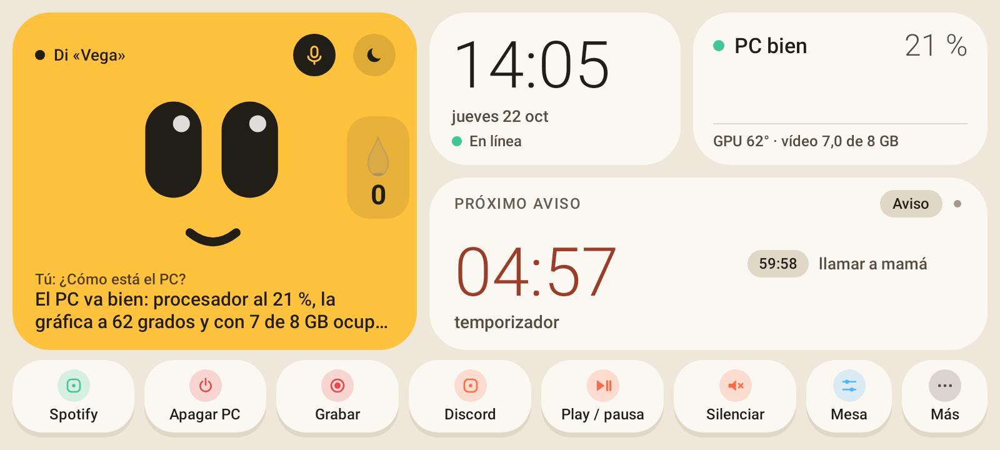
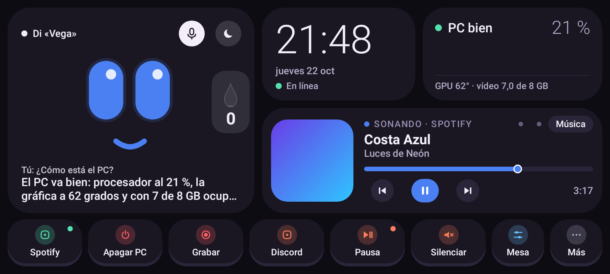
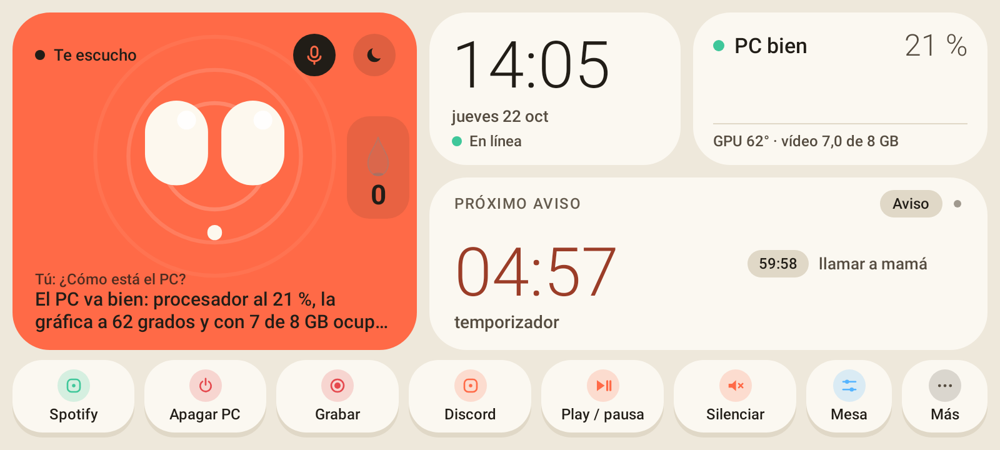
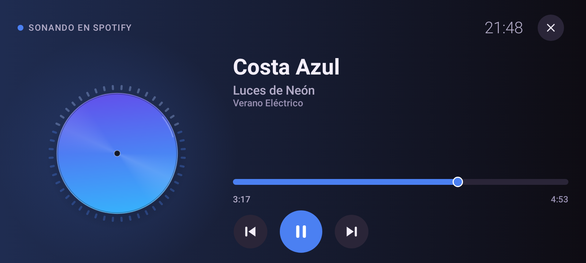
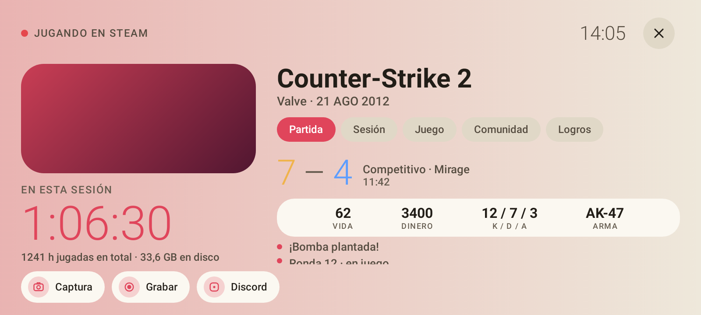
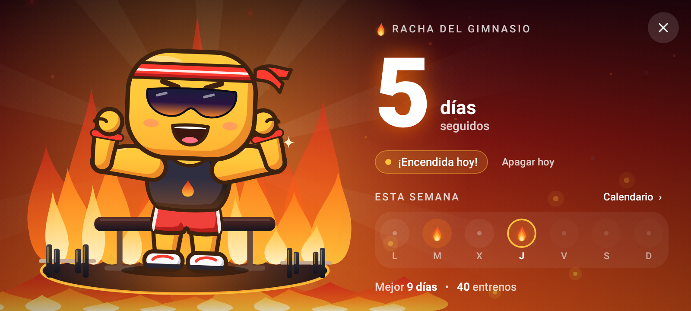
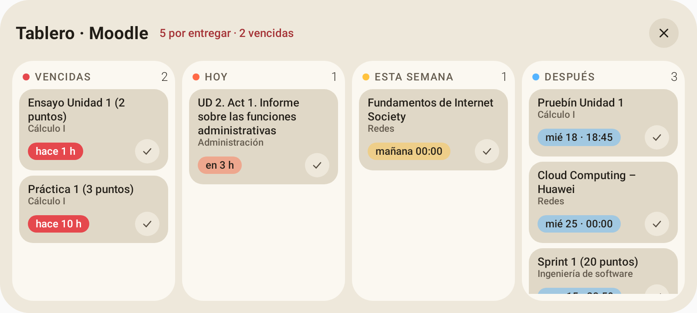
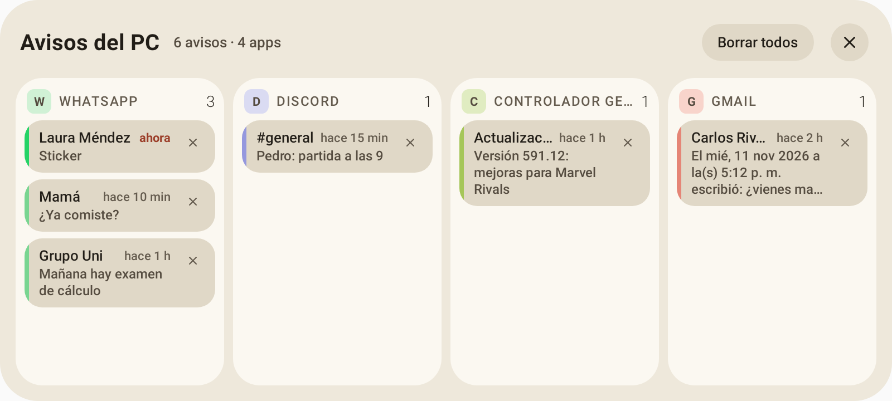
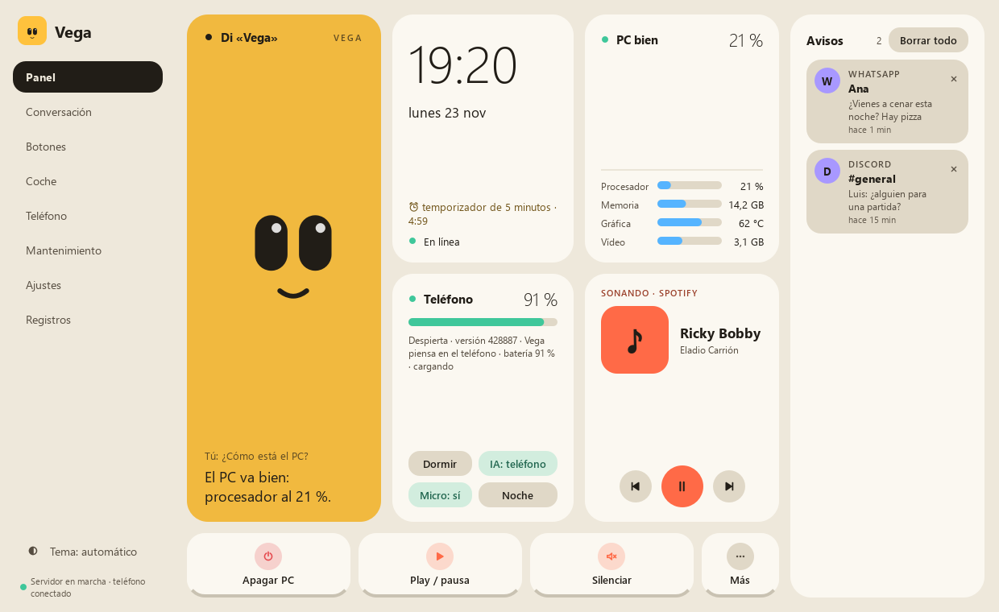
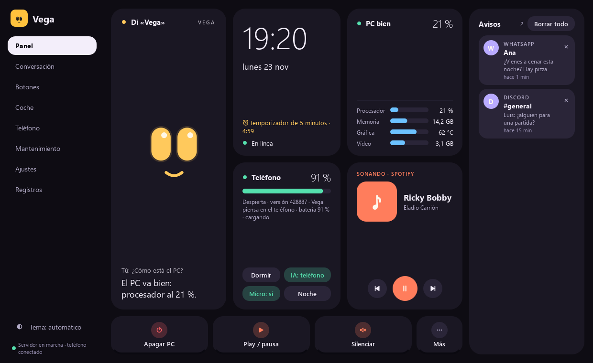

# Vega — a 100 % local voice assistant that gives old phones a second life

**English** · [Español](README.es.md)

Vega is an assistant you talk to ("Vega, …") that is also a **button deck** for your PC (shut down, music, launch
games, per-app volume…), something between Alexa and a Stream Deck.

- **The brain is your PC.** It understands your voice, thinks of an answer and speaks with AI models that run on
  your own computer: no subscriptions, no cloud.
- **The body is an old Android phone** plugged in over **USB**: it gives Vega her face, microphone, speaker,
  screen and keys.
- **The goal: revive old devices.** The phone in your drawer plus an ordinary PC is all you need — no smart speaker
  or new hardware to buy. And it's light on the graphics card: it steps aside by itself while you play.

**Install:** `powershell -ExecutionPolicy Bypass -File scripts\instalar.ps1` (see [Install](#install-windows)).

> **A personal project, still evolving.** It works and is used every day, but expect rough edges. It's
> **Spanish-first**: voice commands, the phone app and most docs are in Spanish today (English is on the roadmap).
> The name "Vega" can be changed in `config/assistant.toml` (or in the desktop app).

| Day | Night |
|---|---|
|  |  |

## What it does

Commands are in Spanish; the English column explains them.

| You say "Vega, …" | What it does |
|---|---|
| «buenos días» · «¿qué tengo hoy?» ("good morning", "what do I have today?") | Daily briefing: reminders, university deadlines, your gym streak and the weather |
| «buenas noches» ("good night") | Pauses the music, tells you what's on tomorrow and your streak, and asks whether to shut down the PC |
| «recuérdame llamar a mamá en 20 minutos / a las 6» ("remind me to call mom in 20 minutes / at 6") | Spoken reminder (and on Telegram if the phone isn't connected) |
| «pon un temporizador de 5 minutos» ("set a 5-minute timer") | Timers and reminders, with a countdown on screen |
| «recuerda que me gusta el café sin azúcar» ("remember that I like coffee without sugar") | Memory about you, also used in conversation |
| «apunta comprar leche» ("note: buy milk") | Notes |
| «¿qué tareas tengo?» · «ya entregué el ensayo» ("what assignments do I have?", "I handed in the essay") | **Moodle:** your deadlines, with an alert 1 hour before they're due |
| «fui al gimnasio» · «¿cómo va mi racha?» ("I went to the gym", "how's my streak?") | **The gym flame:** a streak of days, shown on Vega's face |
| «pon un fondo de anime» · «baja Discord» ("set an anime wallpaper", "turn Discord down") | Wallpaper Engine wallpapers and per-app volume |
| «abre Fortnite» ("open Fortnite") | Launches your Steam and Epic games |
| «apaga el PC» · «sube el volumen» ("shut down the PC", "volume up") | Panel buttons (dangerous ones ask for confirmation) |
| «¿qué tiempo hace?» ("what's the weather?") | Weather (optional, for your city) |
| «cómo está el PC» · «léeme el último mensaje» ("how's the PC?", "read me the last message") | CPU, GPU, memory and phone battery; PC notifications (WhatsApp, Discord…) |
| anything else | A conversation with the language model |

After answering, **it keeps listening for a few seconds without you having to say "Vega" again**.

**And without being asked:**
- **What's playing on the PC** (Spotify, the browser…): cover art, controls and **synced lyrics**.
- **The game you have open**, with your playtime and, for some games, the live match (League of Legends, Rocket
  League, Counter-Strike 2, Forza Horizon…).
- **PC notifications** on the phone, grouped by app.
- **The phone's camera as a Windows webcam** (Discord, the browser…), with one button.
- **Telegram (optional):** message Vega from anywhere, get her reminders, and shut down the PC with confirmation
  buttons.

## The phone: Vega 2

The phone app (Kotlin + Jetpack Compose) is Vega's face and body:

- **Day and night:** paper and ink from 7 am to 8 pm, ink and light the rest of the time (or fixed, if you prefer).
- **A face drawn with curves** that looks around, blinks and changes with her mood: it grows when listening,
  squints while thinking and opens its mouth when talking. You can also see data on it: she **sweats** when the
  GPU runs hot, her eyelids droop when the battery is low, and she wears a **visor** while you play.
- **Big tiles:** the face, the clock, PC status with a live graph, and a "Now" tile that cycles through what
  matters (a notification, Moodle, the PC, your games, the music, the match).
- **Raised keys** with each program's real icon, that act on touch.
- **Dedicated screens:** Music (with lyrics), Game, Moodle board, Notifications, Desk (wallpapers and per-app
  volume) and **Vega Fit**, the gym streak screen.
- **Updates itself from the PC** and can be the phone's home screen.

| Listening | Music | Live game |
|---|---|---|
|  |  |  |

| Vega Fit | Moodle board | PC notifications |
|---|---|---|
|  |  |  |

## The desktop app

A native Windows app with the same design: Vega's face, the PC, the phone, what's playing, notifications and keys.
From it you change settings and buttons, control the phone, and start or stop Vega. It lives in the system tray.

| Day | Night |
|---|---|
|  |  |

## How it works

```
 Old Android phone (native app)          USB cable           Windows PC
 ┌─────────────────────────────┐        (adb reverse)    ┌───────────────────────────────────┐
 │ drawn face (Vega 2)         │ ◄──────────────────────► │ Python server (127.0.0.1:8000)     │
 │ always-on mic, 16 kHz       │   WebSocket: JSON        │  ├─ hears: Whisper                 │
 │ speaker (Vega's voice)      │   events + PCM audio     │  ├─ thinks: Qwen 3.5 4B (Ollama)   │
 │ tiles, keys, screens        │                          │  ├─ speaks: Kokoro / Piper         │
 └─────────────────────────────┘                          │  ├─ skills without AI              │
                                                          │  ├─ Windows buttons and control    │
             Telegram (optional) ◄─────────────────────── │  └─ memory (SQLite)                │
                                                          └───────────────────────────────────┘
```

1. The phone streams its microphone to the PC all the time. The PC detects when a sentence starts and ends and
   transcribes it.
2. If the sentence starts with "Vega" (or you just talked to her), she handles it:
   - first the **skills** (reminders, notes, Moodle, the gym, the PC…): fast, reliable and they don't use the GPU;
   - then the **button phrases** ("shut down the PC"), also matched by meaning;
   - everything else goes to the **language model**.
3. The answer is turned into speech sentence by sentence and plays on the phone while the rest is still being
   generated.

## AI models

Everything is local and free. Measured on the author's PC (RTX 4060 Ti 8 GB, Ryzen 7 5700X, 32 GB RAM).

| For | Model | Where it runs |
|---|---|---|
| Understanding speech | **Whisper** ([faster-whisper](https://github.com/SYSTRAN/faster-whisper)) `small`, with Silero VAD | GPU (~0.2–0.3 s per sentence); while a game is open, `base` on the CPU |
| Thinking of the answer | **Qwen 3.5 4B** via [Ollama](https://ollama.com) | No game: mostly on the GPU (~0.7 s answers); while a game is open, it shrinks to ~700 MB of VRAM |
| Speaking | **Kokoro 82M** ([kokoro-onnx](https://github.com/thewh1teagle/kokoro-onnx)), Latin American Spanish voices | CPU, 3–4× faster than real time |
| Speaking (alternative) | **Piper** | CPU, very fast but more robotic |

**Vega follows your PC:** when you open a game, the model and speech-to-text move to the CPU so the game keeps the
GPU, and they move back 20 s after you close it. **Without an NVIDIA card** it still works: everything runs on the
CPU, just slower.

## Install (Windows)

**What you need**
- Windows 10 or 11, ~6 GB of free disk space and 8 GB of RAM (16 recommended).
- An NVIDIA graphics card helps but is **not required**.
- An **old Android phone** (Android 8 or newer, 64-bit) and its USB cable.

**1. Get Vega**

```powershell
git clone https://github.com/pangel1005/vega.git
cd vega
```

(or *Code → Download ZIP* on GitHub and unzip it).

**2. Run the installer**

```powershell
powershell -ExecutionPolicy Bypass -File scripts\instalar.ps1
```

It installs whatever is missing with winget (uv, Ollama and adb) plus the Python dependencies, creates your
settings based on your graphics card, downloads the language model (~3 GB) and the voices (~120 MB), and asks
whether Vega should start with Windows. It's safe to run again: finished steps are skipped.

**3. Install the phone app**

1. On the phone, enable *Developer options* (tap "Build number" 7 times) and, inside, **USB debugging**. On
   Xiaomi also enable **Install via USB**.
2. Plug it in over USB and accept the prompt on its screen.
3. Run `scripts\android-install.ps1` (the installer also offers it). It builds and installs the app. It needs
   Java 17+ and the Android SDK — the easiest way is to install Android Studio (`winget install
   Google.AndroidStudio`) and open it once; the script finds them by itself.
   - There's no prebuilt APK to download yet: it's on the roadmap.
   - Some Xiaomi phones without a SIM refuse installs over USB: run the script with `-BuildOnly`, copy the APK from
     `android\app\build\outputs\apk\release\` to the phone and install it from the file manager.

**4. Use it**

Start Vega (`scripts\start.ps1`, or automatically if you chose so) and plug in the phone: the server links it and
opens the app by itself. Say "Vega, ¿qué hora es?" ("what time is it?").

**Optional**
- Desktop app: `scripts\escritorio.ps1`.
- Telegram: `uv run python -m server.tools.telegram_setup` · Moodle: `uv run python -m server.tools.moodle_setup`
  ([docs/telegram.md](docs/telegram.md), [docs/moodle.md](docs/moodle.md), in Spanish).
- Phone camera as a webcam: `winget install Genymobile.scrcpy OBSProject.OBSStudio` and `[camera] enabled = true`.
- `scripts\android-debloat.ps1` removes HyperOS ads (reversible with `-Restore`).

**Troubleshooting**

| Problem | Fix |
|---|---|
| "No encuentro Java" / "No encuentro el SDK de Android" (Java / Android SDK not found) | Install Android Studio, open it once and run `scripts\android-install.ps1` again |
| The phone isn't detected | Use a data cable (not charge-only), enable USB debugging and accept the prompt on the phone |
| "El teléfono rechazó la instalación" (the phone refused the install) | Xiaomi: enable *Install via USB*. If Vega was installed from another PC, uninstall it first |
| Vega only writes, doesn't speak | The voices are missing: run `scripts\instalar.ps1` again |
| Answers are very slow | Normal without an NVIDIA card (2–5 s more). Close heavy programs or try a smaller model in `config/assistant.toml` |
| Something else | Check `logs/server.log` |

## Daily use

```powershell
powershell -ExecutionPolicy Bypass -File scripts\start.ps1 -Hidden   # start
powershell -ExecutionPolicy Bypass -File scripts\stop.ps1            # stop and free the GPU
powershell -ExecutionPolicy Bypass -File scripts\autostart.ps1       # start with Windows (-Remove to undo)
```

Starting with Windows is a scheduled task called "Vega (asistente)". Another one, "Vega (vigilante)", checks every
5 minutes that Vega answers and restarts her if she hung. Logs are in `logs/`.

## Configuration

| File | What you change |
|---|---|
| `config/assistant.toml` | Name, model, instructions, voice, Whisper, Telegram, Moodle, camera… It's yours (not in git): created from `config/assistant.example.toml` |
| `config/actions.toml` | Buttons: what they do, which go on the main row, voice phrases and which ask for confirmation. Buttons for programs you don't have are hidden |
| `config/car.toml` | Tiles of Vega's Android Auto screen ([docs/coche.md](docs/coche.md)) |

## Security and privacy

- **Buttons:** only what's listed in `config/actions.toml` exists, and the server always checks it.
- **Confirmation:** shutdown, restart and sleep need a second tap or a spoken "sí". On Telegram, confirmation
  buttons and 60 s to cancel.
- **Audit log:** everything that runs is recorded in `logs/audit.log`.
- **Your PC only:** the server listens only on `127.0.0.1` and requires a token (`config/token.txt`, not in git).
- **Internet, only for what you turn on:** song lyrics ([lrclib.net](https://lrclib.net)), Steam game info, the
  weather, Moodle and Telegram. Each one can be turned off in `config/assistant.toml`. What you say to Vega out
  loud never leaves your PC.

## Project layout

```
.
├── server/              Brain (Python 3.12, FastAPI)
│   ├── core/            Orchestrator (hear → skills/buttons/model → speech), settings, alerts, Telegram
│   ├── speech/          Whisper, Kokoro/Piper, sentence and "Vega" detection
│   ├── llm/             Ollama client
│   ├── skills/          Skills without AI: memory, reminders, notes, Moodle, gym, desk…
│   ├── device/          USB, music, games, Windows notifications, camera, wallpapers, per-app volume
│   ├── memory/          SQLite: history, facts about you, notes, reminders, deadlines, gym
│   ├── tools/           Windows buttons, installer, Telegram and Moodle setup
│   ├── ws/              WebSocket protocol and route
│   └── tests/           Tests (pytest)
├── android/             Phone app (Kotlin + Jetpack Compose)
│   └── app/src/main/java/com/asistente/personal/
│       ├── ui2/         Vega 2: day/night theme, face, tiles, screens
│       ├── ui/          Main screen and shared pieces
│       ├── local/       On-phone AI (no PC): Whisper, Piper, skills
│       ├── car/         Android Auto
│       └── net/, audio/, state/
├── desktop/             Desktop app (PySide6)
├── config/              Default settings, buttons, car and OBS scene
├── scripts/             Install, start, stop, autostart, install the app
├── tools/               Development and benchmarking tools
└── docs/                Docs, roadmap, research and screenshots
```

## Where it's going

[docs/hoja-de-ruta.md](docs/hoja-de-ruta.md) (in Spanish) has the plan: a ready-to-download APK, better "Vega"
detection, more natural conversation, plugins and Wi-Fi. [docs/investigacion/proyectos-similares.md](docs/investigacion/proyectos-similares.md)
compares Vega with similar projects (Home Assistant, xiaozhi, GLaDOS…).

## Development

```powershell
uv run pytest; uv run ruff check server; uv run mypy          # server
uv run --group desktop pytest desktop/tests                     # desktop app
cd android; .\gradlew.bat testDebugUnitTest assembleRelease     # phone app (JDK 21)
```

Both apps' tests **render screenshots** (Roborazzi on Android, headless Qt on the desktop) so the design can be
reviewed without installing anything.

## Tried it? Tell me

Vega is new and I want to know how it works on other PCs and phones, especially old ones. If you try it — even if
you get stuck halfway:

- [🙋 I tried Vega](https://github.com/pangel1005/vega/issues/new?template=probe-vega.yml): how it went, on which PC and phone.
- [🐞 Bug](https://github.com/pangel1005/vega/issues/new?template=fallo.yml) · [💡 Idea](https://github.com/pangel1005/vega/issues/new?template=idea.yml)

If you like it, a ⭐ on GitHub helps other people find it.

## License

MIT — see [LICENSE](LICENSE).
